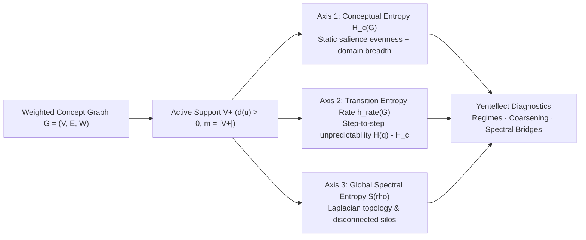

# Cognitive Graph Entropy

**A three-axis information-theoretic and spectral framework for measuring associative structure, transition unpredictability, and domain integration in knowledge graphs.**

Originally developed as the mathematical engine behind [**Yentellect**](https://github.com/rishibagale/yentellect) (a Socratic research workbench and cognitive agent bridge), this repository isolates the formal model, full proofs, claims registry, and a dependency-light Python reference implementation.

---

## What Is This?

When you model a user's or agent's conceptual memory as a weighted undirected graph $G = (V, E, W)$—where nodes are concepts and symmetric edge weights $w_{uv} = w_{vu} \ge 0$ measure association strength—a single "entropy" number is ambiguous.

- A centralized **star graph** ($S_5$) and a **balanced mesh** can both have high degree entropy.
- A rigid **cycle** ($C_6$) and a **complete clique** ($K_6$) have identical degree entropy ($\log_2 6$), even though random associations on $K_6$ are far less predictable step-to-step.
- Adding isolated ("ghost") concepts or uniformly decaying all weights over time can distort naive metrics unless the domain and normalization are invariant.

This framework resolves those ambiguities by modeling an **associative random walk** on the active support $V^+ = \{u \in V : d(u) > 0\}$ and decomposing graph structure into **three orthogonal observables**:



---

## Core Mathematical Framework

Full step-by-step derivations are maintained in [03_math_derivations.md](03_math_derivations.md).

### 1. Active Support & Stationary Random Walk

For a graph with weighted degrees $d(u) = \sum_{v \in V} w_{uv}$ and active support $V^+ = \{u \in V : d(u) > 0\}$ ($m = |V^+| \ge 1$, volume $D = \sum_{u \in V^+} d(u) > 0$), define the one-step associative transition matrix $P_{uv} = w_{uv} / d(u)$.

Because $w_{uv} = w_{vu}$, the degree distribution $\pi(u) = d(u) / D$ is a **reversible stationary distribution** satisfying detailed balance:

$$\pi(u) P_{uv} = \pi(v) P_{vu} = \frac{w_{uv}}{D} =: q_{uv}$$

It is unique if and only if the induced subgraph on $V^+$ is connected (irreducible). When $V^+$ splits into $k > 1$ disconnected conceptual silos, any convex combination of component-wise stationary distributions is stationary.

---

### 2. The Three Observables

| Axis | Observable | Formula (in bits) | What It Measures |
| :--- | :--- | :--- | :--- |
| **Axis 1** | **Conceptual Entropy** | $H_c(G) = -\sum_{u \in V^+} \pi_u \log_2 \pi_u$ | Static salience evenness across active concepts; normalizes cleanly as $\hat{H}_c = H_c / \log_2 m$ without ghost-node dilution. |
| **Axis 2** | **Transition Entropy Rate** | $h_{\text{rate}}(G) = -\sum_{u,v \in V^+} \pi_u P_{uv} \log_2 P_{uv} = H(q) - H_c(G)$ | Conditional step-to-step unpredictability $H(X_1 \mid X_0)$ of associative transitions. |
| **Axis 3** | **Global Spectral Entropy** | $S(\rho) = -\operatorname{Tr}(\rho \log_2 \rho) = -\sum_{i=1}^m \mu_i \log_2 \mu_i$ | Inter-node wiring topology of $L = \operatorname{Deg}_{\text{simple}} - W_{\text{simple}}$ (invariant to self-loops). |

#### Domain-Decomposition Identity (Axis 1)
To separate cross-domain breadth from within-domain depth, partition $V^+$ into disjoint conceptual domains $\mathcal{D} = \{V_1, \dots, V_K\}$ with domain weight shares $p_d = \sum_{u \in V_d} \pi(u)$:

$$H_c(G) = \underbrace{H(p_1, \dots, p_K)}_{H_{\text{between}}(\mathcal{D})\text{ (Domain Breadth)}} + \sum_{d=1}^K p_d \underbrace{H_c(G \mid V_d)}_{\text{Within-Domain Spread}}$$

#### Two Spectral Operators (Axis 3)
1. **Rescaled Combinatorial Laplacian** ([Braunstein, Ghosh, & Severini, 2006](https://arxiv.org/abs/quant-ph/0406165)): $\rho_{\text{BGS}} = L / \operatorname{Tr}(L)$ (requires at least one off-diagonal edge so $\operatorname{Tr}(L) > 0$). Emphasizes high-degree, high-eigenvalue modes.
2. **Diffusion Heat Kernel** ([De Domenico & Biamonte, 2016](https://link.aps.org/doi/10.1103/PhysRevX.6.041062)): $\rho_\beta = e^{-\beta L} / \operatorname{Tr}(e^{-\beta L})$ at diffusion scale $\beta > 0$. Probes multi-scale bottlenecks and counts disconnected conceptual silos directly in the long-time limit:

$$\lim_{\beta \to \infty} S(\rho_\beta) = \log_2 k$$

---

### 3. Key Invariances & Concept Coarsening ($\oplus$)

- **Scale Invariance:** Rescaling all edge weights by $c > 0$ ($w'_{uv} = c \cdot w_{uv}$) leaves $\pi$, $H_c$, $h_{\text{rate}}$, and $\rho_{\text{BGS}}$ unchanged (while shifting heat-kernel scale $\beta \mapsto c\beta$). Uniform exponential weight decay preserves relative cognitive structure.
- **Ghost-Node Invariance:** Adding isolated concepts ($d(u) = 0$) leaves $V^+$, $m$, $H_c$, $\hat{H}_c$, $h_{\text{rate}}$, and $S(\rho)$ unchanged.
- **Loop-Free Lower Bound:** If $G$ has no self-loops and $m \ge 2$, every node satisfies $\pi_u \le \frac{1}{2}$, forcing $1 \le -\log_2 \pi_{\max} \le H_c(G) \le \log_2 m$.
- **Degree-Preserving Coarsening ($z = u \oplus v$):** Merging two distinct active concepts $u \ne v \in V^+$ preserves total volume $D$ and all external degrees via:
  - External edges ($x \notin \{u, v\}$): $w'_{zx} = w'_{xz} = w_{ux} + w_{vx}$
  - Internal self-loop accumulation: $w'_{zz} = w_{uu} + w_{vv} + 2w_{uv}$

  Under $\oplus$, Axis 1 **strictly decreases** by $(a+b)h_2\left(\frac{a}{a+b}\right) > 0$ (where $a=\pi_u, b=\pi_v$), proving $H_c$ is **not ontology-invariant**. By contrast, Axis 2 ($h_{\text{rate}}$) is **non-monotonic** under $\oplus$.

---

## Verifiable Benchmarks

All numbers below are proven in [03_math_derivations.md](03_math_derivations.md) and asserted in [tests/test_framework.py](tests/test_framework.py):

1. **Coarsening Counterexample ($a - b - c$, merge $z = b \oplus c$):**
   - Before merge: $H_c = 1.500\text{ bits}$, $H(q) = 2.000\text{ bits}$, $h_{\text{rate}} = 0.500\text{ bits}$.
   - After merge ($w'_{az} = 1, w'_{zz} = 2$): $H_c' = 0.8113\text{ bits}$ (decreases), $H(q') = 1.500\text{ bits}$, and $h_{\text{rate}}' = \frac{3}{4}\log_2 3 - \frac{1}{2} \approx 0.6887\text{ bits}$ (**increases**).
2. **Iso-Salience Separation ($C_6$ vs $K_6$):**
   - Both regular 6-node graphs share $H_c = \log_2 6 \approx 2.585\text{ bits}$, yet $h_{\text{rate}}(C_6) = 1.000\text{ bit}$ vs $h_{\text{rate}}(K_6) = \log_2 5 \approx 2.322\text{ bits}$.
3. **Spectral Ranking Reversal ($K_5$ vs Star $S_5$, in bits):**

| Graph ($m=5$) | $\rho_{\text{BGS}} = L/\operatorname{Tr}(L)$ | $\rho_{\beta=1} = e^{-L}/\operatorname{Tr}(e^{-L})$ |
| :--- | :---: | :---: |
| Complete $K_5$ ($\lambda = 0,5,5,5,5$) | **$2.000\text{ bits}$** | $0.228\text{ bits}$ ($97.4\%$ weight on $\lambda_1=0$) |
| Star $S_5$ ($\lambda = 0,1,1,1,5$) | $1.549\text{ bits}$ | **$1.855\text{ bits}$** ($99.7\%$ weight across $\{0,1,1,1\}$) |

---

## How It Is Applied in Yentellect

In [**Yentellect**](https://github.com/rishibagale/yentellect), a researcher's evolving notes, extracted concepts, and discovered cross-domain isomorphisms form a live semantic graph:

| Mathematical Concept | Implementation in `rishibagale/yentellect` | Role in the Workbench |
| :--- | :--- | :--- |
| Graph $G = (V, E, W)$ & Ebbinghaus decay | `backend/core/graph.py` (`KnowledgeGraph`) | Stores concept nodes, domains, Hebbian edge weights (`strengthen_edge`), and exponential confidence decay. |
| Active support $V^+$, $H_c$, $h_{\text{rate}}$, $\oplus$ | `backend/graph.py` (`compute_observables`, `coarsen_nodes`) | Evaluates walk observables on $V^+$ using stub-weight self-loop convention $W_{uu} = 2w_{\text{loop}}(u) = w_{uu}$. |
| Cognitive regime classification | `backend/orchestrator.py` (`CognitiveGraphOrchestrator`) | Classifies the graph state into `INACTIVE`, `FIXATED` (low $\hat{H}_c$), `COMPARTMENTALIZED` (low spectral connectivity $\lambda_2$), `RIGID_ROUTINE` (high $\hat{H}_c$, low $\hat{h}_{\text{rate}}$), or `INTEGRATED`. |
| Spectral silo bridging & fusion | `recommend_spectral_bridge` & `fuse_concepts` | Uses Laplacian eigenvectors (Fiedler potential) to suggest cross-domain bridges and pairs concept synthesis with theoretical $\Delta H_c$ drop. |

*(Note: `yentellect/backend/graph.py` pairs $H_c$ and $h_{\text{rate}}$ with the normalized Laplacian spectral gap $\lambda_2(L_{\text{sym}})$ for bottleneck routing; this repository formalizes the complementary trace-normalized Laplacian spectral entropies $S(\rho_{\text{BGS}})$ and $S(\rho_\beta)$ from the same Laplacian spectrum.)*

---

## Quick Start (Python Reference)

Requires Python $\ge 3.10$ and `numpy`:

```bash
pip install -e .
python -m unittest discover -s tests -v
```

Example usage:

```python
import numpy as np
from cognitive_graph_entropy import compute_all_observables, merge_nodes

# Path graph a - b - c
W = np.array([
    [0.0, 1.0, 0.0],
    [1.0, 0.0, 1.0],
    [0.0, 1.0, 0.0],
])

before = compute_all_observables(W)
after = compute_all_observables(merge_nodes(W, 1, 2))  # z = b (+) c

print(f"Before: H_c={before.H_c:.3f}, h_rate={before.h_rate:.3f}")
print(f"After:  H_c={after.H_c:.3f}, h_rate={after.h_rate:.3f}")
```

---

## Scientific Scope & Claims Discipline

Every mathematical and cognitive claim in this repo is tracked with explicit falsification status in [00_claims_registry.md](00_claims_registry.md):

- **`[PROVEN]`**: Shannon uniqueness (A1–A3 via integer squeeze), detailed balance on $V^+$, scale/ghost invariance, domain-decomposition identity, strict $H_c$ decrease and $h_{\text{rate}}$ non-monotonicity under $\oplus$.
- **`[CITED]`**: Graph-entropy framing ([Körner, 1973](https://doi.org/10.1016/B978-0-12-565850-8.50009-3); [Dehmer & Mowshowitz, 2011](https://doi.org/10.1016/j.ins.2010.08.041)) and Laplacian spectral entropies ([Braunstein et al., 2006](https://arxiv.org/abs/quant-ph/0406165); [De Domenico & Biamonte, 2016](https://link.aps.org/doi/10.1103/PhysRevX.6.041062)). The entropy formulas themselves are **not** claimed as new mathematics (`C-1.5`); the contribution is the cognitive operationalization, multi-axis separation, and coarsening analysis.
- **`[HYP]`**: Whether the 3-axis observables empirically track human/agent conceptual breadth and reasoning regimes under a fixed ontology and edge-weight definition (`C-1.4`).
- **Scope limitation:** Undirected weights $w_{uv} = w_{vu}$ enforce time-reversibility ($q_{uv} = q_{vu}$); modeling directional logical implication ($A \implies B$) requires a directed Perron–Frobenius extension.

---

## Repository Contents

- [README.md](README.md) — Overview, 3-axis summary, benchmarks, and Yentellect mapping
- [03_math_derivations.md](03_math_derivations.md) — Complete derivations, proofs, bounds, and counterexamples
- [00_claims_registry.md](00_claims_registry.md) — Claims status ledger (`[PROVEN]`, `[CITED]`, `[HYP]`, `[OVERCLAIM]`)
- [cognitive_graph_entropy.py](cognitive_graph_entropy.py) — Standalone NumPy reference implementation
- [tests/test_framework.py](tests/test_framework.py) — Unit tests verifying every theorem and worked example
- [pyproject.toml](pyproject.toml) & [LICENSE](LICENSE) — Package metadata & MIT License

---

## References

- Braunstein, S. L., Ghosh, S., & Severini, S. (2006). *The Laplacian of a Graph as a Density Matrix: A Basic Combinatorial Approach to Separability of Mixed States*. Annals of Combinatorics, 10(3), 291–317. [`arXiv:quant-ph/0406165`](https://arxiv.org/abs/quant-ph/0406165)
- De Domenico, M., & Biamonte, J. (2016). *Spectral Entropies as Information-Theoretic Tools for Complex Network Comparison*. Physical Review X, 6(4), 041062. [`doi:10.1103/PhysRevX.6.041062`](https://link.aps.org/doi/10.1103/PhysRevX.6.041062)
- Dehmer, M., & Mowshowitz, A. (2011). *A history of graph entropy measures*. Information Sciences, 181(1), 57–78.
- Körner, J. (1973). *Coding of an information source having ambiguous alphabet and the entropy of graphs*. Transactions of the 6th Prague Conference on Information Theory, 411–425.
- Shannon, C. E. (1948). *A Mathematical Theory of Communication*. Bell System Technical Journal, 27(3), 379–423.

---

## License

MIT © 2024–2026 Rishi Bagale
